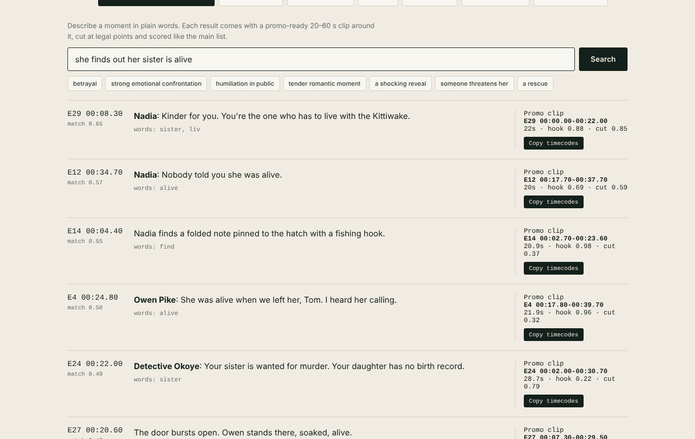
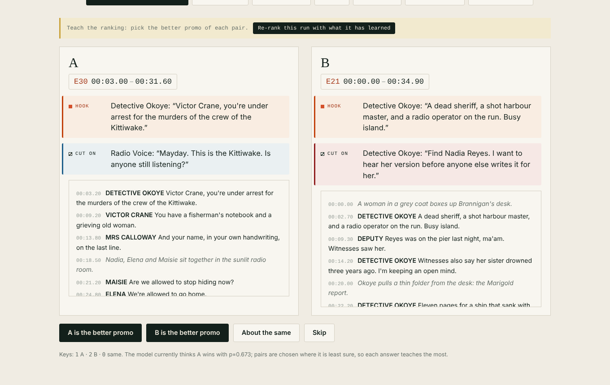

# PromoFinder

Find the best 20–60 second promo clips in a microdrama, straight from its timestamped screenplays.
You get a ranked list, plus spoiler checks, audience angles, natural-language scene search, and a ranking that learns from your editors.


Upload a show's screenplays (`.zip`, `.txt`, `.srt`, `.vtt` or `.json`). Each candidate promo comes with:

- exact episode timecodes for every segment, cut only between lines of dialogue
- the hook (first 3 s), the cliffhanger at the cut, and the line the viewer is denied
- one line on why it works, and a score breakdown
- **spoiler risk**: does it give away a twist or the ending? The reveal the *title* promises counts as a premise payoff, not a spoiler
- **angle**: romance, revenge, power reveal, danger, mystery, family or humor
- stability and risk flags, plus the source line numbers in the screenplay

Exports: JSON, CSV, Markdown, an offline HTML report and **CMX3600 EDLs** for Premiere Pro or DaVinci Resolve.
Everything runs on a laptop CPU with no API key. An LLM second opinion is optional.

---

## Quick start

**1. Download and extract the ZIP once.**

**2. Run the launcher.**

| System | What to do |
|---|---|
| macOS / Linux | Open a terminal in the folder and run `./run.sh`. If it says *permission denied*, run `bash run.sh`. |
| Windows | Double-click `run.bat`. |

On the first launch the launcher finds Python 3.10+ and creates a private environment in `.venv`. It then installs the dependencies (about a minute, needs internet), creates `.env` for optional API keys, starts PromoFinder and opens <http://localhost:7860> in your browser.

**3. Next time, just run the launcher again.** It starts in a second or two. It only reinstalls dependencies when `requirements.txt` changes, and it rebuilds `.venv` by itself if the folder was moved to another computer.

You need **Python 3.10 or newer**. If it's missing, the launcher tells you how to install it. On Windows, tick *Add python.exe to PATH* in the installer.

Other launcher commands:

```bash
./run.sh check                      # verify the environment, start nothing
./run.sh test                       # run the 80 automated tests
./run.sh cli run show.zip --out outputs/my_show       # command line (see below)
./run.sh reset                      # delete .venv; the next launch rebuilds it
```

On Windows, use `run.bat check`, `run.bat test`, `run.bat cli ...` and `run.bat reset`.

---

## Using it

### In the browser

1. **Upload** the show's screenplays, or open one of the two sample shows.
2. **Choose an audience and a spoiler setting.** *General* uses the plain ranking. *Romance seekers*, *Revenge & underdog*, *Suspense & thriller*, *Mystery*, *Status-reveal*, *Family* and *Humor* nudge close calls toward clips that sell that angle. Spoilers can be *Balanced* (penalise clear twists), *Strict* or *Off*.
3. Review the results in five tabs:
   - **Top**: the ranked shortlist. Use **Use / Reject** on each pick, and copy timecodes in one click (keys: `J`/`K` move, `U` use, `R` reject, `C` copy).
   - **Longlist**: 50 diverse candidates.
   - **Portfolio**: the best clip for each angle, not overlapping each other. This is a ready set of creatives to A/B test against different ad audiences.
   - **Search**: describe a moment in plain words, e.g. *"she is humiliated in front of everyone"* or *"betrayal"*. Every hit comes with a promo-ready 20–60 s clip around it.
   - **Compare A/B**: PromoFinder shows the two clips it is least sure how to order, and you pick the better promo (keys `1` / `2` / `0`). After 10 judgments the ranking uses what it learned. *Re-rank this run* applies it to the current results immediately.
4. **Export**: EDLs, cut list, CSV, JSON, Markdown, portfolio.


| Scene search | A/B compare |
|---|---|
|  |  |

### On the command line

```bash
./run.sh cli run show.zip --out outputs/show                          # rank promos
./run.sh cli run show.zip --audience thriller --spoilers strict       # target an audience, avoid reveals
./run.sh cli run show.zip --llm gemini                                # add an LLM second opinion (key in .env)
./run.sh cli search outputs/show "she finds out her sister is alive"  # scene search on a finished run
./run.sh cli eval outputs/show --source show.zip                      # check every pick against the scripts
./run.sh cli learn feedback/feedback.jsonl                            # show what the editors have taught it
./run.sh cli performance outputs/show ad_results.csv                  # import measured ad results
```

The launcher is optional: with the dependencies installed, `python -m promofinder ...` and `python app.py` work the same way.

### Screenplay formats

| Format | Example | Notes |
|---|---|---|
| Production format | `**MARA (Cold):**` / `Start: (00:11.30) \| End: (00:13.10)` / text | Full information. Parsed by the original parser, so results are unchanged. |
| Variants | headers without `**`, timing on the header line, `[00:11.3 --> 00:13.1]` | Same result as the production format. |
| Inline | `[00:11.3 - 00:13.1] MARA (Cold): text`, or start times only | `SCENE 12` / `INT.` lines keep scene boundaries. |
| JSON | `{"episode": 1, "logline": "...", "blocks": [{"start", "end", "kind", "speaker", "tags", "text"}]}` | Lossless. A natural output for AI script generators. |
| SRT / WebVTT | `MARA: text`, `[MARA] text`, `[door slams]` | Subtitles have no camera or action lines, so visual hooks can't be detected. The app says so. |

The format is detected from the content of each file, and mixed formats in one ZIP are fine.

---

## Optional: LLM second opinion

The core ranker never needs an LLM. If you add one, it reads only the shortlist (about 30 clips, roughly 50 calls per show) and does two jobs:

1. **Rubric scores**: hook, cliffhanger, standalone, spoiler-safety and overall, rank-averaged with the system score.
2. **One pairwise pass over the final list**: each adjacent pair is judged twice with the order swapped. A clip only moves if the verdict survives the swap, because LLM judges favour whichever option is shown first.

Set it up in `.env`. It is created on first launch, stays on your computer, is git-ignored, and keys are never written to any output:

```bash
PROMOFINDER_LLM_PROVIDER=gemini      # gemini | groq | openrouter | ollama | anthropic | openai | openai_compatible
GEMINI_API_KEY=your-key-here
```

| Free option | Key from | Notes |
|---|---|---|
| Gemini | https://aistudio.google.com/apikey | `gemini-2.5-flash` by default |
| Groq | https://console.groq.com/keys | `llama-3.3-70b-versatile` |
| OpenRouter | https://openrouter.ai/keys | `:free` models |
| Ollama | none | runs locally: `ollama pull llama3.1` |

To swap the model, set `PROMOFINDER_LLM_MODEL`; any OpenAI-compatible server works through `openai_compatible` plus `PROMOFINDER_LLM_BASE_URL`. No SDK is installed: calls are plain HTTPS. Responses are cached in `.llm_cache/`, so a re-run costs nothing, and a failed or malformed answer falls back to the system score.

Once a key is set, the upload page shows an *LLM second opinion* checkbox, and `./run.sh check` confirms which provider is active.

---

## How it works

```
screenplays ─► format adapters ─► block table (every line, shot, action, tag, timestamp, source line)
                                        │
            ┌───────────────────────────┼─────────────────────────────────┐
     legal cut points          series index (premise, names,      reveal index (cues + loglines,
   (never inside a line)        LSA space, who's introduced)        premise & free-episode exemptions)
            │                           │                                  │
   hook scorer (weak supervision)   cliffhanger scorer (open loop + withheld payoff)
            └──────────── 51k candidate clips (single, cross-episode, cold open) ─────┐
                                                                                      │
   score = weighted geometric mean(hook, cliff, standalone, intensity, premise)       │
           × duration fit × early-episode prior × spoiler factor × audience factor ◄──┘
                                        │
             diverse selection (MMR, no overlaps, ≤ 2 per episode) ─► top / longlist / portfolio
                                        │
     optional LLM second opinion ◄──────┤──────► editor feedback (Use/Reject, A/B, measured CTR)
                                        │               └─► Bradley–Terry weights ─► next run
                                exports + web app + search index
```

| Module | Job |
|---|---|
| `formats.py`, `parser.py`, `ingest.py` | Format detection and safe ZIP and file loading |
| `features.py`, `models.py`, `labelmodel.py` | Hook and cliffhanger moment scorers (weak supervision, cross-fitted by episode) |
| `pipeline.py` | Candidate generation, components, scoring, diversity, stability |
| `spoilers.py` | Reveal index and spoiler risk |
| `profiles.py` | Angles, audience profiles, portfolio |
| `search.py` | Hybrid scene search and the clip around each hit |
| `preferences.py` | Learning from editors, active pair selection, measured results |
| `llm.py` | Optional providers, cache, debiased judging |
| `evaluate.py` | Constraint checks, spoiler exposure, run agreement |
| `export.py`, `report.py`, `edl.py`, `app.py` | Outputs, report, cut lists and EDLs, web app |

Design notes, rejected ideas and evaluation details are in [docs/IMPROVEMENTS.md](docs/IMPROVEMENTS.md).

## How good is it

All numbers come from real runs. The development show is the 50-episode, 103-minute pack from the brief; it is confidential and not included. "Silver" labels were written by Claude from the episode loglines **before** the feature they test was built. They are not editor labels.

| Check | v1.3 | v2.0 |
|---|---|---|
| Hard constraints on 12 picks and 50-clip longlist (20–60 s, no cut inside a line, inside the episode, no overlaps, EDL = JSON) | 0 violations | 0 violations |
| Labelled twists or endings shown in the top 12 | 2 | 1 |
| … in the 50-clip longlist | 5 | 2 |
| Same picks as v1.3 (exact / same moment) | – | 9 / 10 of 12, same #1 |
| Scene search, 16 paraphrased queries: relevant episode in the top 5 | no search | 16/16, MRR 0.67 (plain keyword BM25 baseline: 9/16, MRR 0.48) |
| Same show converted to JSON / inline / unbolded production format: same top 12 | could not read them | 12 / 12 / 12 |
| … with delivery tags removed / as SRT subtitles | could not read them | 8 / 4 of 12 moments kept |
| Time for 50 episodes on a 2-core cloud VM (scoring 51,598 clips) | 5.9 s | 8.0 s |
| Automated tests (Python 3.10 and 3.13) | 47 | 80 |

**Learning from editors (simulation, not real editors).** Three simulated editors with hidden tastes judged clips from the real longlist, with noise (36 runs per cell, Kendall τ against the editor's own ranking of 50 clips):

| Judgments | Use/Reject votes | Random A/B pairs | Active A/B pairs |
|---|---|---|---|
| 0 (default weights) | 0.731 | 0.731 | 0.731 |
| 10 | 0.743 | 0.737 | **0.759** |
| 20 | 0.715 | 0.755 | **0.786** |
| 40 | 0.738 | 0.789 | **0.815** |

Active A/B selection learns fastest. Use/Reject votes alone barely move the ranking, because the clips an editor sees together are all strong and similar. The prior strength and pool size were chosen on this same simulation.

## Known limitations

- **Spoiler detection relies on the loglines.** Cue patterns alone found 1 of 9 labelled twists; with Kuku's EPISODE LOGLINE it found 8 of 9. Because the labels were also written from loglines, that 8/9 is optimistic. It misses twists phrased without a cue word (e.g. a marriage declared invalid). Use Strict mode for late-series material, and keep a human check on anything flagged *late-series*.
- **Angles are lexical.** A clip about a missing daughter can be tagged *romance* if it uses love words. Treat the angle as a hint.
- **Search synonyms are a hand-written genre list.** It was written after reading this show's loglines, so the 16/16 result is optimistic for other genres. Installing `model2vec` (see `.env`) adds a real embedding model; that path is implemented but was not benchmarked here because the model could not be downloaded in the build environment.
- **No real engagement data yet.** Scores estimate promo quality; they are **not** predicted click-through rates. Measured results can be imported (`promofinder performance`) and then appear as *Measured* badges and feed the learner. Nothing in the app invents a CTR.
- **Subtitle-only input is much weaker**: 4 of 12 moments survive, because there are no action lines and no delivery tags.
- **Windows launcher.** `run.bat` follows the same steps as `run.sh` but could not be executed in the build environment. `run.sh` was tested from a clean extract, including repeat launch, a busy port and a damaged `.venv`.
- **Single process.** One scoring run at a time, with job state held in memory. That suits one editor or a small team, not many concurrent users.

## Configuration

`config.yaml` holds clip lengths, number of picks, weights, spoiler tolerance, audience, learning and LLM settings. Each key is commented, and the defaults are in `promofinder/config.py`. Editor judgments are stored in `feedback/feedback.jsonl`. Learned weights apply automatically once 10 judgments exist; set `learning.auto_apply: false` (or pass `--no-learning`) to rank with the fixed weights.

## Troubleshooting

| Problem | Fix |
|---|---|
| `permission denied: ./run.sh` | Run `bash run.sh` (ZIP extraction can drop the execute bit), or `chmod +x run.sh`. |
| "Python 3.10 or newer was not found" | Install from python.org. Windows: tick *Add python.exe to PATH*. Ubuntu: `sudo apt install python3 python3-venv`. |
| Dependency install fails | Check your internet connection, then run the launcher again. To start clean: `./run.sh reset`. |
| Port 7860 is busy | PromoFinder picks the next free port and prints the address. To choose one: `PORT=8000 ./run.sh`. |
| The browser didn't open | Open the address printed in the terminal (usually <http://localhost:7860>). |
| "No screenplay found in the upload" | The files need timestamps (see *Screenplay formats*). The page lists every skipped file. |
| The LLM checkbox doesn't appear | Set `PROMOFINDER_LLM_PROVIDER` and the matching key in `.env`, restart, and run `./run.sh check`. |
| Search says "made by an older version" | Re-run the show; runs from v1.x have no search index. |
| Open from another computer on your network | `HOST=0.0.0.0 ./run.sh`. Only do this on a network you trust: there is no login. |

## Deploy

`render.yaml` is a Render Blueprint and the `Dockerfile` works on any Docker host. Both use gunicorn in public mode, which hides other visitors' runs, keeps the upload cap small and disables the LLM checkbox. `/healthz` reports the version.

## AI tools

| Tool | How it was used |
|---|---|
| Claude (Anthropic) | v1: main coding partner, plus blind silver labels for hooks and endings. v2: the audit, research-backed design decisions, the implementation, the tests, the evaluation scripts and this README, with every claim checked by a run or a test. |
| Grok | v1: brainstorming and second opinions. |
| Lovable | v1: visual design of the web app (implemented as plain server-rendered HTML and CSS). |

Mistakes caught by measuring rather than trusting:

| What went wrong | How it showed up | Fix and check |
|---|---|---|
| Learning from writers' episode endings | Held-out AUC 0.61; top features were writing style | Replaced by the withheld-payoff scorer (0.80 AUC on silver labels) |
| Hook rules vetoed real hooks | "They arrested her!" penalised on blind sample A | Rules removed, re-checked on a fresh sample B |
| Learned weights barely moved, then hurt | Prior strength 4: no change after 40 judgments. Prior 0.05: τ fell from 0.73 to 0.64 | Swept the prior, used active pair selection: τ rose steadily to 0.815 |
| Spoiler cue flagged known facts | "You are my father!" in episode 5 counted as a reveal | Cues only count if new relative to the free episodes and the title |
| Spoiler cue missed "you're under arrest" | Seen on the sample show's A/B screen | Contractions added; development-show numbers unchanged |
| Format conversion "changed" rankings | Inline copy of the show: 9/12 overlap | Missing scene markers; once added, 12/12 |
| Python 3.10 crashed on a ZIP edge case | `metadata_encoding` exists only from 3.11 | A portable codec fallback; full test suite passes on 3.10 and 3.13 |
