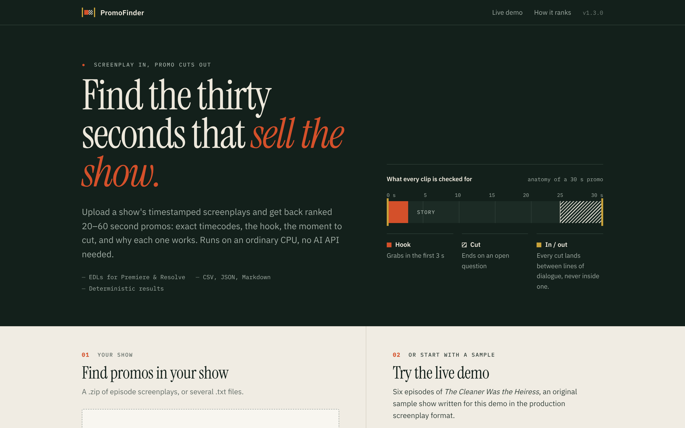
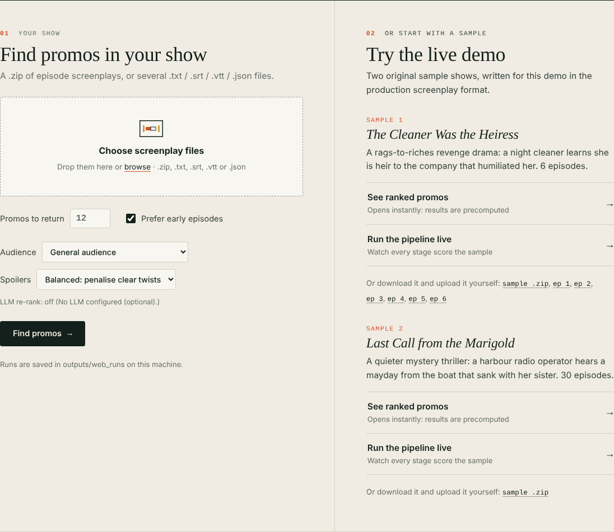
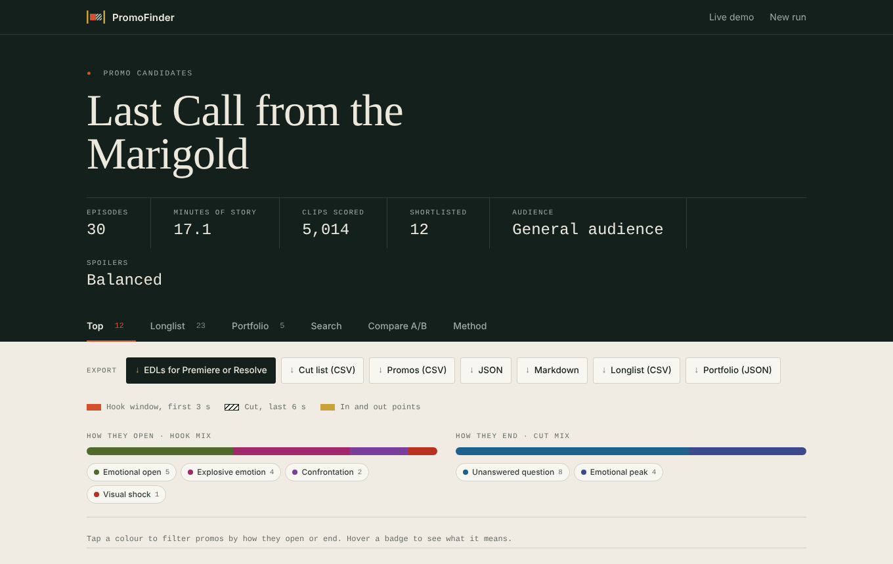
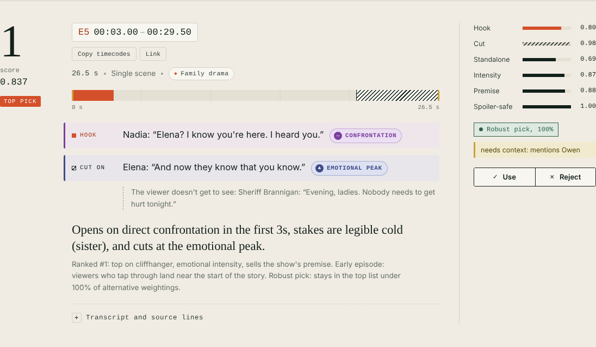
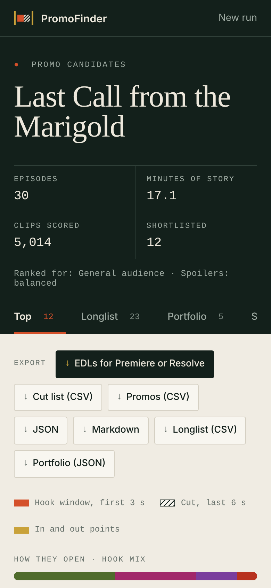
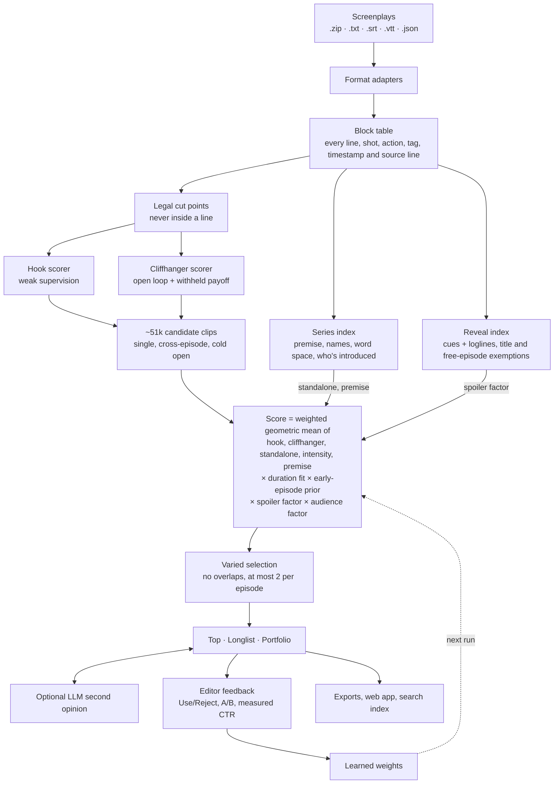

# PromoFinder

PromoFinder finds the best 20–60 second promo clips in a microdrama, working straight from its timestamped screenplays.
It ranks the candidates, flags clips that give away the plot, suggests angles for different audiences, lets you search for a moment in plain words, and learns from your editors' choices.

**Live demo:** [promofinder-h00l.onrender.com](https://promofinder-h00l.onrender.com). Open either sample show for instant results.



Upload a show's screenplays (`.zip`, `.txt`, `.srt`, `.vtt` or `.json`). Every candidate promo comes with:

- exact timecodes for each segment, always cut between lines of dialogue, never inside one
- the hook (first 3 seconds), the cliffhanger it ends on, and the next line the viewer doesn't get to hear
- a one-line reason it works, and a score breakdown
- a **spoiler check**: does the clip give away a twist or the ending? A reveal the *title* already promises is treated as the selling point, not a spoiler
- an **angle**: romance, revenge, power reveal, danger, mystery, family or humor
- a stability badge, risk flags, and the screenplay line numbers it came from

You can export JSON, CSV, Markdown, an offline HTML report, and **CMX3600 EDLs** for Premiere Pro or DaVinci Resolve.
Everything runs on an ordinary CPU with no API key. An LLM second opinion is optional.

---

## Quick start

1. **Download and extract the ZIP** (or clone the repo).
2. **Run the launcher:** double-click `run.bat`, or run `.\run.bat` in PowerShell.

   The first launch finds Python 3.10 or newer, sets up a private environment in `.venv`, installs the dependencies (takes about a minute and needs internet) and creates a `.env` file for optional API keys. Then it starts PromoFinder and opens <http://localhost:7860>.
3. **After that, just run the launcher again.** It starts in a couple of seconds. It only reinstalls dependencies when `requirements.txt` changes, and it rebuilds `.venv` by itself if the folder moves to another computer.

If Python is missing, the launcher tells you how to install it. Tick *Add python.exe to PATH* in the Python installer.

Other launcher commands:

```powershell
.\run.bat check                                  # check the setup without starting anything
.\run.bat test                                   # run the 80 automated tests
.\run.bat cli run show.zip --out outputs\show    # use the command line (see below)
.\run.bat reset                                  # delete .venv so the next launch rebuilds it
```

---

## Using it

### In the browser

1. **Upload** the show's screenplays, or open one of the two sample shows.
2. **Pick an audience and a spoiler setting.**
   - *General audience* gives the plain ranking. The other audiences (*Romance seekers*, *Revenge & underdog*, *Suspense & thriller*, *Mystery*, *Status-reveal*, *Family*, *Humor*) nudge close calls toward clips that suit them.
   - *Balanced* spoiler mode penalises clear twists, *Strict* avoids any reveal, and *Off* ignores spoilers.

   

3. **Go through the results tabs:**
   - **Top**: the ranked shortlist. Mark each pick **Use** or **Reject** and copy its timecodes in one click (keys: `J`/`K` to move, `U` use, `R` reject, `C` copy).
   - **Longlist**: up to 50 varied candidates.
   - **Portfolio**: the best clip for each angle, none overlapping, ready to A/B test against different ad audiences.
   - **Search**: describe a moment, e.g. *"the sheriff is lying"* or *"betrayal"*. Each result comes with a promo-ready 20–60 s clip around it.
   - **Compare A/B**: PromoFinder shows you the two clips it is least sure how to order, and you pick the better promo (keys `1` / `2` / `0`). Once there are 10 judgments, new runs on your machine use what it learned. *Re-rank this run* applies it to the results you're looking at right away.
   - **Method**: how the scores are made.
4. **Export** EDLs, the cut list, CSV, JSON, Markdown or the portfolio.



Here is one pick up close. The strip is drawn to scale: red is the 3-second hook window, hatching is the final 6 seconds, gold marks the in and out points.



| Scene search | A/B compare |
|---|---|
|  |  |

<table>
<tr>
<td width="38%"></td>
<td><b>Portfolio and phones.</b> The Portfolio tab gives one clip per angle (<a href="docs/screenshots/portfolio.png">screenshot</a>). The whole app also works on a phone, so you can review picks away from the edit suite.</td>
</tr>
</table>

### On the command line

```powershell
.\run.bat cli run show.zip --out outputs\show                       # rank promos
.\run.bat cli run show.zip --audience thriller --spoilers strict     # target an audience, avoid reveals
.\run.bat cli run show.zip --llm gemini                              # add an LLM second opinion (key in .env)
.\run.bat cli search outputs\show "the sheriff is lying"             # search a finished run
.\run.bat cli eval outputs\show --source show.zip                    # check every pick against the scripts
.\run.bat cli learn feedback\feedback.jsonl                          # see what the editors have taught it
.\run.bat cli performance outputs\show ad_results.csv                # import real ad results
```

The launcher is just a convenience. With the dependencies installed, `python -m promofinder ...` and `python app.py` work the same way.

### Screenplay formats

| Format | Example | Notes |
|---|---|---|
| Production format | `**MARA (Cold):**`, then `Start: (00:11.30) \| End: (00:13.10)`, then the line | Full information. Read by the original parser, so results haven't changed. |
| Variations of it | headers without `**`, timing on the header line, `[00:11.3 --> 00:13.1]` | Same results as the production format. |
| Inline | `[00:11.3 - 00:13.1] MARA (Cold): text`, or start times only | `SCENE 12` and `INT.`/`EXT.` lines keep scene boundaries. |
| JSON | `{"episode": 1, "logline": "...", "blocks": [{"start", "end", "kind", "speaker", "tags", "text"}]}` | Nothing is lost. A natural format for AI script generators. |
| SRT / WebVTT | `MARA: text`, `[MARA] text`, `[door slams]` | Subtitles have no camera or action lines, so visual hooks can't be found. The app warns you. |

The format is detected from each file's content, so one ZIP can mix formats.

---

## Optional: LLM second opinion

The ranking never needs an LLM. If you add one, it only reads the shortlist (about 30 clips, roughly 50 calls per show) and does two things:

1. **Scores each clip** on hook, cliffhanger, standalone clarity, spoiler safety and overall, and blends that with PromoFinder's own ranking.
2. **Compares neighbouring picks in pairs**, asking about each pair twice with the order swapped. LLMs tend to favour whichever option they see first, so a clip only moves up if the LLM picks it both times.

Set it up in `.env`. The launcher creates that file on first run; it stays on your computer, git ignores it, and keys never appear in any output.

```ini
PROMOFINDER_LLM_PROVIDER=gemini      # gemini | groq | openrouter | ollama | anthropic | openai | openai_compatible
GEMINI_API_KEY=your-key-here
```

| Free option | Get a key at | Default model |
|---|---|---|
| Gemini | https://aistudio.google.com/apikey | `gemini-2.5-flash` |
| Groq | https://console.groq.com/keys | `llama-3.3-70b-versatile` |
| OpenRouter | https://openrouter.ai/keys | a `:free` model |
| Ollama | no key, runs on your machine | `llama3.1` (`ollama pull llama3.1`) |

To use a different model, set `PROMOFINDER_LLM_MODEL`. Any OpenAI-compatible server works through `openai_compatible` plus `PROMOFINDER_LLM_BASE_URL`. No SDK is needed: the calls are plain HTTPS. Answers are cached in `.llm_cache/`, so re-running a show costs nothing, and if a call fails, that clip simply keeps its normal score.

Once a key is set, the upload page shows an *LLM second opinion* checkbox, and `.\run.bat check` tells you which provider is active.

---

## How it works



| Module | What it does |
|---|---|
| `formats.py`, `parser.py`, `ingest.py` | Detect the format, load ZIPs and files safely |
| `features.py`, `models.py`, `labelmodel.py` | Score hooks and cliffhangers (weak supervision, cross-fitted by episode) |
| `pipeline.py` | Build candidates, score them, keep the list varied, measure stability |
| `spoilers.py` | Find reveals and score spoiler risk |
| `profiles.py` | Angles, audience profiles, portfolio |
| `search.py` | Scene search and the clip around each result |
| `preferences.py` | Learn from editors, choose the next A/B pair, use measured results |
| `llm.py` | Optional LLM providers, cache, order-swapped comparisons |
| `evaluate.py` | Check runs against the scripts, measure spoilers and agreement |
| `export.py`, `report.py`, `edl.py`, `app.py` | Outputs, report, cut lists and EDLs, web app |

The design reasoning, the ideas I rejected and the evaluation details are in [docs/IMPROVEMENTS.md](docs/IMPROVEMENTS.md).

---

## How good is it

Every number below comes from a real run on the 50-episode, 103-minute pack from the brief. That pack is confidential and not included here. There are no editor labels yet: the "silver" labels were written by Claude from the episode loglines **before** the feature they test existed.

| Check | v1.3 | v2.0 |
|---|---|---|
| Rule breaks in the 12 picks and the 50-clip longlist (outside 20–60 s, cut inside a line, outside the episode, overlapping, EDL not matching JSON) | none | none |
| Labelled twists or endings shown in the top 12 | 2 | 1 |
| … in the 50-clip longlist | 5 | 2 |
| Same picks as v1.3 (exact clip / same moment) | – | 9 / 10 of 12, same #1 |
| Scene search, 16 reworded queries: right episode in the top 5 | no search | 16/16, MRR 0.67 (plain keyword search: 9/16, MRR 0.48) |
| Same show converted to JSON / inline / production format without bold | couldn't read them | same top 12 each time |
| … with delivery tags removed / as SRT subtitles | couldn't read them | 8 / 4 of the 12 moments kept |
| Time for 50 episodes on a 2-core cloud machine (51,598 clips scored) | 5.9 s | about 8 s |
| Automated tests (Windows, Python 3.14) | 47 | 80 |

**Learning from editors.** This was tested in a simulation, not with real editors. Three made-up editors with hidden preferences judged clips from the real longlist, with some randomness in their answers. I ran each setting 36 times and measured how closely the learned ranking matched each editor's own (Kendall τ over 50 clips, where 1 means identical):

| Judgments | Use/Reject votes | Random A/B pairs | Chosen A/B pairs |
|---|---|---|---|
| 0 (default weights) | 0.731 | 0.731 | 0.731 |
| 10 | 0.743 | 0.737 | **0.759** |
| 20 | 0.715 | 0.755 | **0.786** |
| 40 | 0.738 | 0.789 | **0.815** |

Letting PromoFinder choose which pair to show learns fastest. Use/Reject votes alone hardly help, because the clips an editor sees together are all strong and similar. One caveat: I picked the learning settings using this same simulation.

---

## Known limitations

- **Spoiler detection leans on the episode loglines.** Without them, the cue words alone caught 1 of 9 labelled twists; with Kuku's `EPISODE LOGLINE` lines it caught 8 of 9. That 8/9 is optimistic, because my labels came from the loglines too. It still misses twists that don't use a cue word, such as a marriage being declared invalid. Use *Strict* for late-series material and have a person check anything flagged *late-series*.
- **Angles are based on word lists**, so they can be wrong. A scene about a missing daughter can come out as *romance* if the characters talk about love. Treat the angle as a hint.
- **Search works best with concrete descriptions.** "The sheriff is lying" or "a mayday on the radio" find the right scenes; vague phrases like "a shocking reveal" are hit-and-miss, especially in scripts without delivery tags. The synonym list was also written after I read this show's loglines, so the 16/16 above is probably optimistic for other genres. You can add a real embedding model (see `.env`); that option is built but untested, because the model couldn't be downloaded where I built this.
- **There's no real engagement data yet.** Scores estimate promo quality; they are **not** predicted click-through rates. You can import real ad results (`promofinder performance`). They then show up as *Measured* badges and feed the learning. The app never makes up a CTR.
- **Subtitle files are much weaker input.** Only 4 of 12 moments survive, because there are no action lines or delivery tags.
- **One run at a time.** Jobs are held in memory, which is fine for one editor or a small team but not for many people at once.

## Settings

`config.yaml` holds clip lengths, number of picks, weights, spoiler setting, audience, learning and LLM options. Every key has a comment, and the defaults live in `promofinder/config.py`. Editor judgments are saved in `feedback/feedback.jsonl`. Once there are 10 of them, local runs use the learned weights automatically. To turn that off, set `learning.auto_apply: false` or pass `--no-learning`.

## Troubleshooting

| Problem | Fix |
|---|---|
| "Python 3.10 or newer was not found" | Install it from python.org and tick *Add python.exe to PATH*. |
| Installing dependencies fails | Check your internet connection and run the launcher again. To start fresh: `.\run.bat reset`. |
| Port 7860 is in use | PromoFinder picks the next free port and prints the address. To choose one yourself: `$env:PORT=8000; .\run.bat`. |
| The browser didn't open | Open the address printed in the terminal, usually <http://localhost:7860>. |
| "No screenplay found in the upload" | The files need timestamps (see *Screenplay formats*). The page lists every file it skipped. |
| No LLM checkbox | Set `PROMOFINDER_LLM_PROVIDER` and the matching key in `.env`, restart, then run `.\run.bat check`. |
| Search says the run was made by an older version | Run the show again; runs from v1.x have no search index. |
| Opening it from another computer on your network | Start it with `$env:HOST="0.0.0.0"; .\run.bat`. Only do this on a network you trust, because there's no login. |

## Deploying

`render.yaml` is a Render Blueprint, and the `Dockerfile` works on any Docker host. Both run PromoFinder in public mode:

- other visitors' runs are hidden;
- uploads are capped at 20 MB;
- the LLM option is turned off, and votes are stored but don't change the ranking.

Render's free plan also wipes files whenever the service restarts, so keep real editor feedback on a local copy. Don't upload confidential scripts to the public demo. `/healthz` reports the running version.

## AI tools

| Tool | How I used it |
|---|---|
| Claude (Anthropic) | v1: main coding partner, and the blind silver labels for hooks and endings. v2: Claude Code did the audit and most of the implementation, tests, evaluation scripts and documentation from my brief, with every claim backed by a test or a measured run. |
| Grok | v1: brainstorming and second opinions. |
| Lovable | v1: visual design of the web app, built as plain server-rendered HTML and CSS. |

These are the mistakes that measuring caught, where trusting the first idea would have shipped them:

| What went wrong | How it showed up | What fixed it |
|---|---|---|
| Learning cliffhangers from how writers end episodes | Held-out AUC 0.61; the model picked up writing style, not suspense | Replaced with the withheld-payoff scorer (0.80 AUC on silver labels) |
| Hook rules vetoed real hooks | "They arrested her!" was penalised in blind sample A | Removed the rules, re-checked on a fresh sample B |
| Learned weights barely moved, then made things worse | Prior strength 4: no change after 40 judgments. Prior 0.05: τ dropped from 0.73 to 0.64 | Tried a range of values and let PromoFinder choose the pairs: τ rose steadily to 0.815 |
| The spoiler check flagged things viewers already know | "You are my father!" in episode 5 counted as a reveal | A cue now counts only if it's new compared with the title and the free episodes |
| The spoiler check missed "you're under arrest" | Spotted on the sample show's A/B screen | Contractions added; results on the development show didn't change |
| Converting the show to another format seemed to change the ranking | Inline copy kept only 9 of 12 picks | Scene markers were missing; with them, 12 of 12 |
| Python 3.10 crashed on one kind of ZIP | `metadata_encoding` only exists from Python 3.11 | A fallback that works on every version; tests pass on 3.10, 3.13 and 3.14 |
| `run.bat` would have skipped installing on a fresh Windows PC | First Windows run printed a mangled `python.exe" -c` error | Rewrote that step to avoid the Windows quoting bug; checked on Windows with Python 3.14 |
